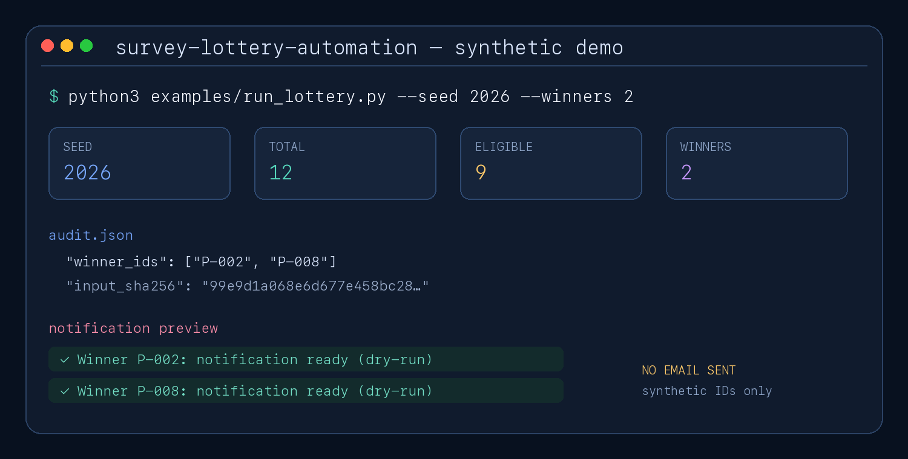
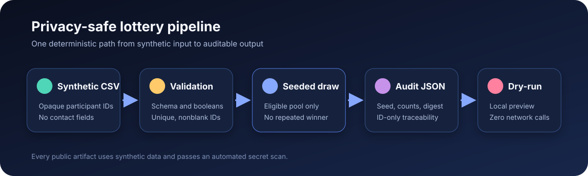

# Survey Lottery Automation

[](https://www.python.org/)
[](https://github.com/Hunter20041004/survey-lottery-automation/actions/workflows/ci.yml)
[](PRIVACY.md)
[](https://colab.research.google.com/github/Hunter20041004/survey-lottery-automation/blob/main/notebooks/Survey_Lottery_Automation.ipynb)

**A reproducible, auditable pipeline that validates survey responses, draws winners with a recorded seed, and previews notifications, rebuilt from a real campaign with 1,000+ responses.**

把真實問卷抽獎（1,000 多份回覆）重建成可重現、可稽核的自動化流程。

> **Type** Student organization project (NCCU Career Month) · **Status** Completed (2026-07) · **Role** Solo project · **Stack** Python (standard library), Google Colab, GitHub Actions



## Background

NCCU Career Month ran a survey campaign with more than 1,000 responses. My original Google Colab script read the responses from Google Sheets, picked winners with a fixed serial-number rule, and emailed them through Gmail. This public version keeps the real problem but rebuilds it properly, using synthetic data only.

## What it does

- **Validates the input** and rejects malformed rows, duplicate IDs and impossible draw sizes.
- **Draws winners with a seed**, so anyone can reproduce the same result.
- **Writes a privacy-safe audit record** for every draw.
- **Previews notifications locally** (dry run) instead of sending email.



```text
Synthetic CSV
    → strict validation
    → eligible participant pool
    → seeded, non-repeating draw
    → privacy-safe JSON audit
    → local notification preview
```

## Key decisions

| Decision | Why |
| --- | --- |
| Seeded random draw instead of the original suffix rule | Anyone can re-run the draw and get the same winners, which makes it auditable. |
| Small dependency-free Python modules instead of one Colab cell | Each step can be tested on its own. |
| No credentials and synthetic IDs only | The real campaign involved participants' contact details; none of it belongs in a public repository. |
| Dry-run previews instead of SMTP sending | Nothing can be emailed by accident. |

## Results

- Replaces a one-off notebook used on a real 1,000+ response campaign with a tested, reproducible pipeline (the public version runs on synthetic data).
- 18 tests at real boundaries: temporary CSV files, a subprocess CLI run, notebook JSON and tracked-file secret scanning, with CI on pushes and pull requests.

## Run it locally

Requires Python 3.11 or newer.

```bash
git clone https://github.com/Hunter20041004/survey-lottery-automation.git
cd survey-lottery-automation
python3 -m venv .venv
source .venv/bin/activate
python3 -m pip install -e .
python3 examples/run_lottery.py --seed 2026 --winners 2
```

The first output line is a JSON audit record. Subsequent lines are local notification previews marked `dry-run`.

Data contract, audit record, tests and repository structure: [`docs/DETAILS.md`](docs/DETAILS.md).

## Notes

- The public demo does not connect to a live Google Sheet.
- It does not send email or map IDs to real contact information.
- A seed makes a draw reproducible, not unpredictable; use an independently generated and recorded seed when procedural fairness requires one.

## 中文摘要

政大徵才月的問卷活動有超過 1,000 份回覆，原本用 Colab 從 Google 試算表讀資料、依固定尾號規則抽獎再用 Gmail 寄信。公開版保留問題背景，但全面改用合成資料，加入輸入驗證、可重現抽獎、稽核紀錄、dry-run 通知與安全測試；不公開任何參與者個資或憑證。

## License

[MIT](LICENSE)
